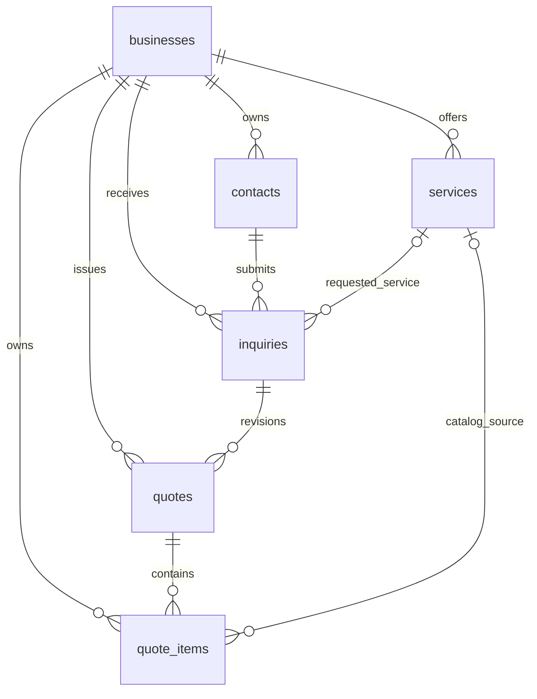

# Database design

The initial schema is [backend/app/db/001_initial.sql](../backend/app/db/001_initial.sql), targeting PostgreSQL 14 or newer. It creates exactly the six requested tables. Apply it once to an empty application database:

```bash
psql "$DATABASE_URL" -v ON_ERROR_STOP=1 -f backend/app/db/001_initial.sql
psql "$DATABASE_URL" -v ON_ERROR_STOP=1 -f backend/tests/schema_smoke.sql
```

The second command tests constraints and generated amounts with rolled-back fixtures. The migration runs in a transaction. Future changes should be incremental migrations rather than editing and rerunning this file on an existing database.

## Python models and API schemas

The [`backend/app/models`](../backend/app/models) package provides SQLAlchemy 2 mappings for the existing tables. Importing it registers all six tables in `Base.metadata` without connecting to or changing a database:

```python
from backend.app.models import Base, Business, Contact, Service, Inquiry, Quote, QuoteItem
```

Column types, nullability, server defaults, CHECK/UNIQUE constraints, composite foreign keys, generated columns and indexes match the SQL migration. Status columns remain VARCHAR in PostgreSQL. Generated totals are logically nonnull because their inputs are required, but their ORM metadata preserves the SQL declaration's nullable flag. UUIDs and timestamps are generated by PostgreSQL and become available after a session flush. `updated_at` uses `FetchedValue` so SQLAlchemy fetches the value maintained by the existing database trigger. Apply the migration to initialize a database; `Base.metadata.create_all()` does not create those triggers.

Tenant relationships include business ID in their joins. Only the related record ID is synchronized by the relationship; the business ID must be assigned explicitly (or through `.business`) on every new tenant-owned object, including nested quote items. Assigning a contact/service/quote from another business therefore fails a foreign key instead of moving the object into another tenant. This follows SQLAlchemy's guidance on [overlapping foreign keys](https://docs.sqlalchemy.org/en/20/orm/join_conditions.html#overlapping-foreign-keys).

Relationships use `lazy="raise"` to make database loading explicit. Use `selectinload(Quote.items)` before serializing `QuoteRead`, and load contact, requested service and quote headers for `InquiryDetailRead`. Quote items are ordered by position and use delete-orphan cascading; removing a line from a draft's item collection deletes it. The application must still enforce draft-only edits/deletes. JSONB dictionaries track top-level edits; replace the dictionary when editing nested JSON values so SQLAlchemy detects the change.

The [`backend/app/schemas`](../backend/app/schemas) package provides the following Pydantic 2 types:

| Record | Owner input | Owner output |
| --- | --- | --- |
| Business | `BusinessCreate` | `BusinessRead` |
| Contact | `ContactCreate` | `ContactRead` |
| Service | `ServiceCreate` | `ServiceRead` |
| Inquiry | `InquiryCreate` | `InquiryRead`, `InquiryDetailRead` |
| Quote | `QuoteCreate` with nested items | `QuoteSummaryRead`, `QuoteRead` with items |
| Quote item | `QuoteItemCreate` | `QuoteItemRead` |

`PublicInquiryCreate` nests a `PublicContactCreate` and excludes owner-only fields. `PublicQuoteRead` and `PublicQuoteItemRead` are explicit customer projections. `QuoteSendRequest` validates an aware expiration timestamp; the service must check it is in the future. `QuoteAcceptanceRead` represents the acceptance response. Enum types enumerate the database's permitted inquiry statuses, quote statuses and preferred contact channels.

Read schemas use [Pydantic's `from_attributes`](https://docs.pydantic.dev/latest/concepts/models/#arbitrary-class-instances) and can serialize loaded ORM instances with `QuoteRead.model_validate(quote)`. Token hashes are excluded from every response schema. Inputs reject unknown fields and exclude tenant IDs, generated IDs/timestamps, quote status/revision and generated totals. The service derives these from authenticated context, path parameters and database calculations. `QuoteCreate` accepts draft snapshot content, discount/tax and at least one item; it does not accept subtotal or total. Compute subtotal from the validated items when constructing the ORM quote.

API validation is deliberately stricter than SQL in a few places: names, email addresses and phone numbers are trimmed, timezone names must be valid IANA identifiers, submitted quantities/amounts must be integers within PostgreSQL ranges, timestamps must include a timezone, and a new quote must have at least one item with unique positions. Nullable fields remain nullable, and JSONB objects use independent dictionary defaults. Email/phone fields enforce length and nonblank content; identity verification and normalization remain application responsibilities. Validation does not replace tenant authorization, state transitions or transactional price recalculation.

Install dependencies and run the mapping/schema checks from the repository root:

```bash
python -m pip install -e '.[test]'
python -m unittest discover -s backend/tests -p 'test_*.py' -v
```

The tests parse both the migration and ORM-generated PostgreSQL DDL with `pglast`, comparing column types, nullability, defaults, generated expressions, constraints and indexes. They also check relationship synchronization, public response filtering and input validation. If `TEST_DATABASE_URL` is set to an authenticated development database URL, an additional test exercises actual inserts, generated totals, timestamp triggers, serialization and cross-tenant rejection; its fixtures are rolled back. A password-free URL requires working PostgreSQL credential configuration such as `.pgpass`, since this test does not prompt for a password.

## Relationships



| Table | Purpose and important fields |
| --- | --- |
| `businesses` | Tenant, unique public `slug`, contact information, IANA timezone, default currency, active flag, address. Owner authentication/membership is a later concern. |
| `contacts` | Business-specific customer, name, email and/or phone, preferred channel, private notes, archive timestamp. A contact may submit many inquiries. |
| `services` | Business catalog, optional starting price, duration, display order, unit label and active flag. A NULL base price means individualized pricing; zero means free. |
| `inquiries` | Contact, optional primary requested service, vehicle and condition details, service address, preferred time window, lead status, internal notes, loss reason and retry key. |
| `quotes` | Inquiry and revision, recipient/vehicle/address snapshots, currency, amounts, terms, status, public token hash, expiry, response timestamps and follow-up scheduling fields. |
| `quote_items` | Ordered quote lines with optional source service, snapshot name/description/unit/price/duration, quantity and generated line total. Custom lines have no service ID. |

Every row has a UUID primary key and `created_at`/`updated_at` timestamps. The database generates IDs and maintains `updated_at` with triggers. All timestamps use `timestamptz`; business timezone controls local display and scheduling rules. Validate IANA timezone names in the application; the default is UTC.

## Tenant boundaries and indexes

Every tenant-owned table has `business_id`. Composite foreign keys such as `(business_id, contact_id)` ensure that an inquiry cannot reference another business's customer. Equivalent constraints protect services, quotes and quote items. The apparently redundant `(business_id, id)` unique constraints are the targets for these foreign keys. See [PostgreSQL's constraint documentation](https://www.postgresql.org/docs/14/ddl-constraints.html).

These constraints protect relationships. API authorization must still scope every owner query to the authenticated business; UUIDs are not access control. There is no row-level security policy or user authentication implemented in this migration. Public responses must explicitly select safe fields and exclude internal notes, token hashes and unrelated contact records.

Inbox indexes begin with business ID and support both all-lead and status-filtered listings. Use keyset pagination ordered by `(created_at DESC, id DESC)`. Contact history and foreign-key lookups have matching indexes. Quote revisions and line positions have scoped unique indexes. A partial unique index allows only one accepted quote per inquiry. Separate due-time indexes support workers scanning sent quotes across businesses for follow-ups and expiry.

Contacts are not globally shared between businesses. Email and phone lookup indexes are deliberately nonunique because families and organizations may share them. Normalize email and phone in the application; do not merge contacts based only on an unverified email/phone. Keep inquiry creation and contact creation in one transaction. A supplied `submission_key`, unique per business, prevents duplicate inquiries on retries; a retry must return the existing result and verify payload compatibility. It is not a contact identity key.

## Pricing and historical records

All monetary amounts use integer minor units, e.g. `15000` for USD 150.00. Fractional quantities are intentionally excluded in this detailing MVP: quantity counts vehicles or service units. Services use the business currency; copy that currency into each new quote and do not change a business currency without converting/replacing its catalog. The API must validate supported currency codes and their minor-unit precision.

Quote items snapshot catalog values. Editing a service or customer later does not rewrite sent quotes. Quote-level recipient, vehicle, address and terms snapshots also preserve what the customer saw. Archive contacts and deactivate services; referenced parent rows cannot be hard-deleted. Deleting a quote cascades its items, so application permissions must allow quote deletion only for drafts and retain sent/accepted records.

`line_total_minor = quantity * unit_price_minor` and `total_minor = subtotal_minor - discount_minor + tax_minor` are generated columns. Discounts cannot exceed subtotal, and amounts cannot be negative. When saving a draft and before sending, the application must lock the quote and recalculate `subtotal_minor` from its items, calculate tax/discount using the business's rules, and save everything in one transaction. PostgreSQL CHECK constraints cannot validate a sum across child rows; see the [CHECK constraint limitations](https://www.postgresql.org/docs/14/ddl-constraints.html#DDL-CONSTRAINTS-CHECK-CONSTRAINTS).

Only drafts may have their content/items edited. Make corrections after sending as a new quote revision, superseding the previous open revision. Status transitions and snapshot immutability must be enforced by the application; this schema enforces allowed values and key timestamp consistency, not the entire state machine. Allocate revision numbers under an inquiry row lock; do not use an unlocked `MAX(revision) + 1`.

## Endpoint behavior supported by this schema

| Endpoint | Database operation |
| --- | --- |
| `POST /public/businesses/{slug}/inquiries` | Resolve an active business by slug; validate the requested service belongs to it and is active; create/reuse a verified contact and insert an inquiry atomically. Derive business ID on the server. |
| `GET /inquiries` | Tenant-scoped, paginated inquiry list; optionally filter status. |
| `GET /inquiries/{id}` | Tenant-scoped inquiry with contact, requested service and quote history. |
| `GET /services` | Tenant-scoped catalog; normally active services sorted by display order. |
| `POST /inquiries/{id}/quotes` | Lock inquiry, allocate revision, copy snapshots, create a draft and its ordered items in a transaction. |
| `GET /quotes/{id}` | Tenant-scoped quote with items ordered by position. |
| `POST /quotes/{id}/send` | Lock draft, validate nonempty items and snapshots, recalculate amounts, issue token/expiry, supersede older open revisions and set `sent`/`sent_at`/`next_follow_up_at`. Set inquiry to `quoted`. |
| `GET /public/quotes/{token}` | Hash token and look up its unique digest; check status/expiry; return a customer-safe snapshot and optionally update first-view timestamp. |
| `POST /public/quotes/{token}/accept` | Lock inquiry then quote, recheck `sent` and expiry, set `accepted`/`accepted_at`, clear follow-up time and mark inquiry `won`/`closed_at` atomically. Repeat acceptance should return the existing successful result. |

These are implementation contracts for future endpoints; this change does not implement their handlers. Use a consistent lock order (inquiry, quote) whenever both rows are needed to avoid deadlocks. An acceptance transaction must reject a competing accepted revision, supersede other open revisions and clear their follow-up times. Expiry checks use database time; the API must reject expired links even if an expiry worker has not updated status yet.

Generate tokens using `secrets.token_urlsafe(32)` in Python and persist only `hashlib.sha256(token.encode()).digest()`. The raw token appears in the customer link, never in database storage or logs. Require expiry for sent quotes. Sending retries should not continually rotate links: define idempotent send behavior and delivery retries in the future service/outbox layer. A hash alone cannot reconstruct the original link for a resend or follow-up; a delivery worker will need an encrypted token/link payload or an explicit token rotation policy.

Email/SMS delivery, follow-up execution and scheduling require a worker and a durable outbox/delivery table; the six core tables do not guarantee message delivery. A worker can query `next_follow_up_at`, but must lock and recheck status before claiming work, and coordinate retries through that future delivery layer.

## Workflow after the six-table MVP

Inquiry statuses represent opportunities: `new → reviewing → quoted → won/lost`, with `cancelled` also available. A terminal status requires `closed_at`. Quote statuses represent an offer: `draft → sent → accepted/declined/expired`, plus `superseded` and `cancelled`. Clear `next_follow_up_at` whenever a quote leaves `sent`.

Acceptance wins an opportunity; it does not mean that a detailing job has been completed. Add a `jobs` table with business/contact/accepted quote references, scheduled start/end, job status and completion timestamp. If customers provide only preferred dates, acceptance must lead to scheduling confirmation rather than treating their preference as a confirmed booking. Add separate reminder/outbox records for booking reminders and repeat-booking outreach after completion. Keep multiple jobs and reminder history out of inquiry/quote status fields.

The requested endpoint list has no decline endpoint. To implement that branch later, add `POST /public/quotes/{token}/decline`, record `declined_at`/`decline_reason`, clear follow-ups and mark the inquiry `lost` atomically according to the owner's policy. Expiry or silence should not automatically imply a customer declined.

An inquiry currently has one optional primary requested service plus free-text details. A quote may contain many services. If the public form needs multiple structured service selections before quoting, add an `inquiry_services` join table later. If customers need a reusable multi-vehicle garage, introduce a `vehicles` table while retaining inquiry/quote snapshots.
